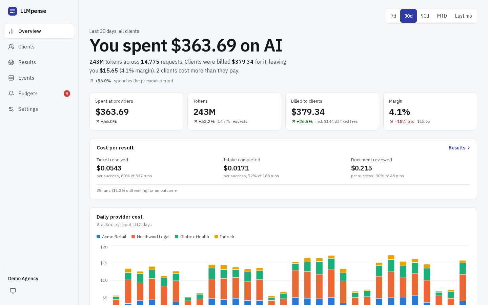
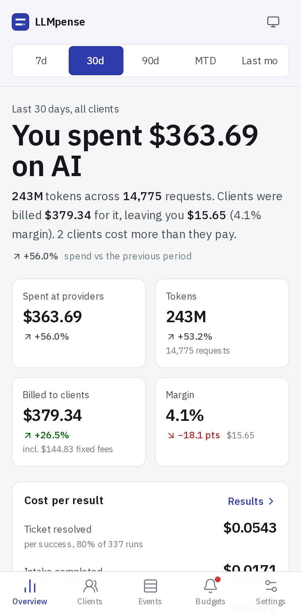
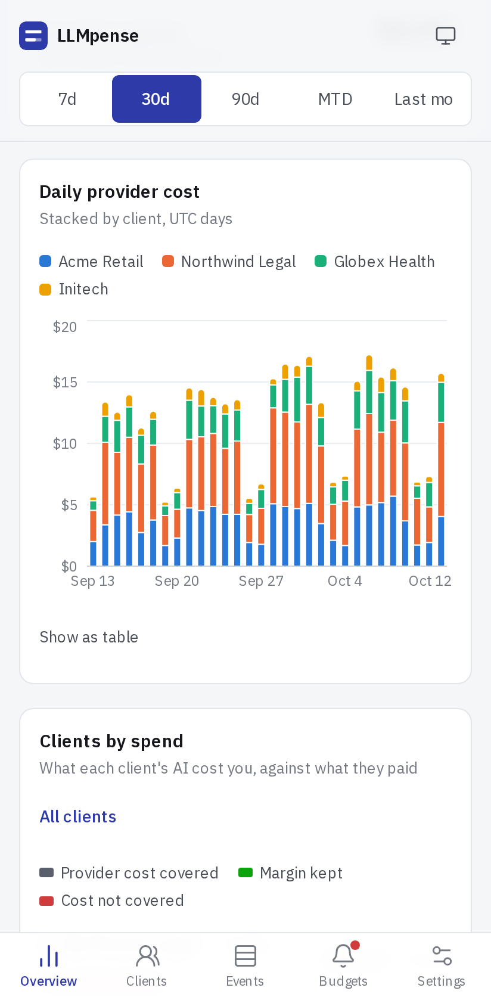
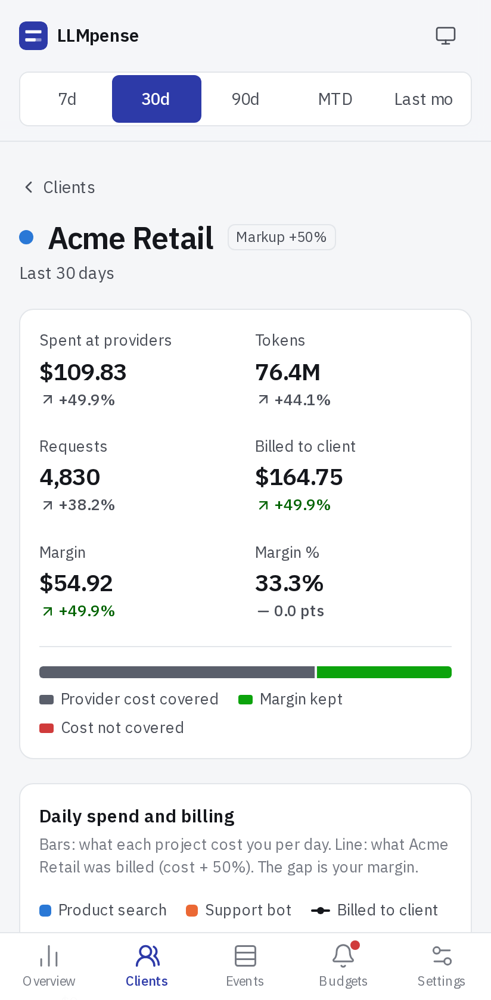
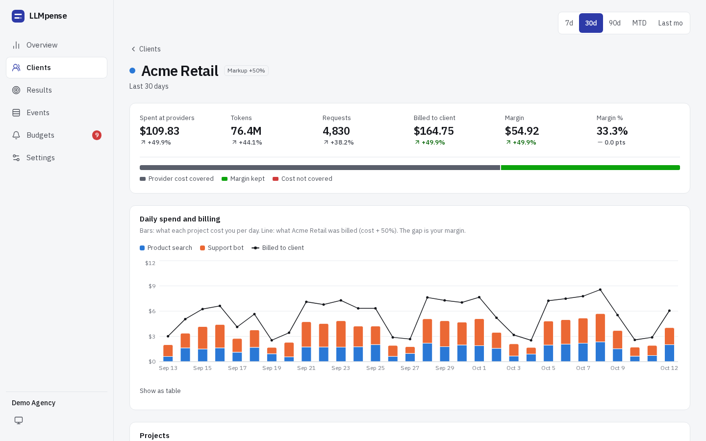
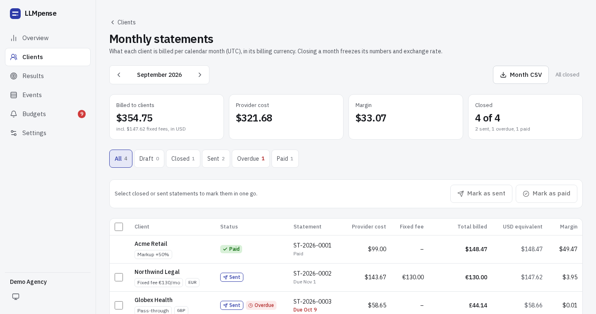
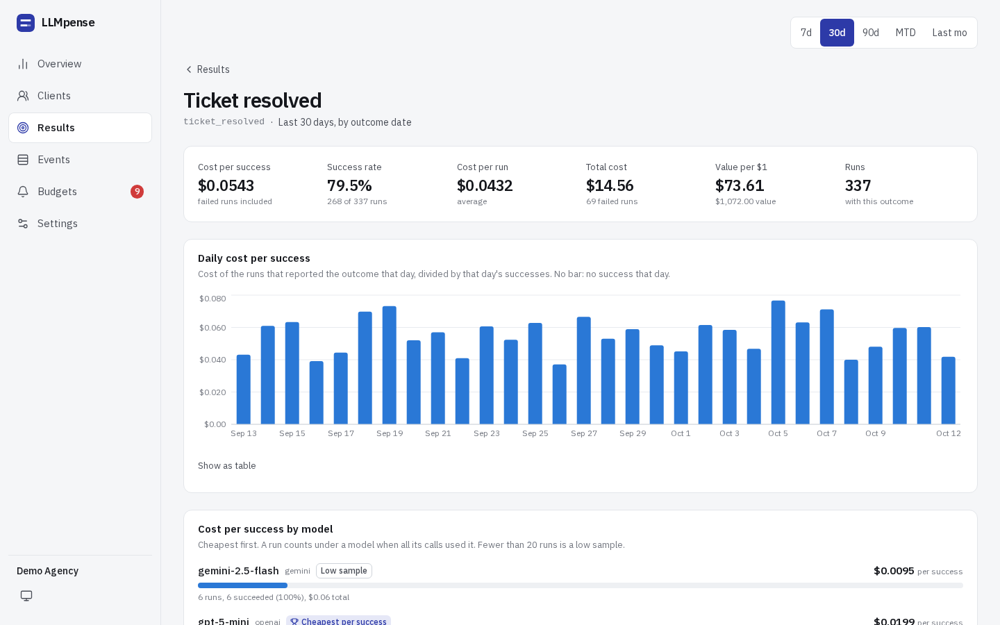
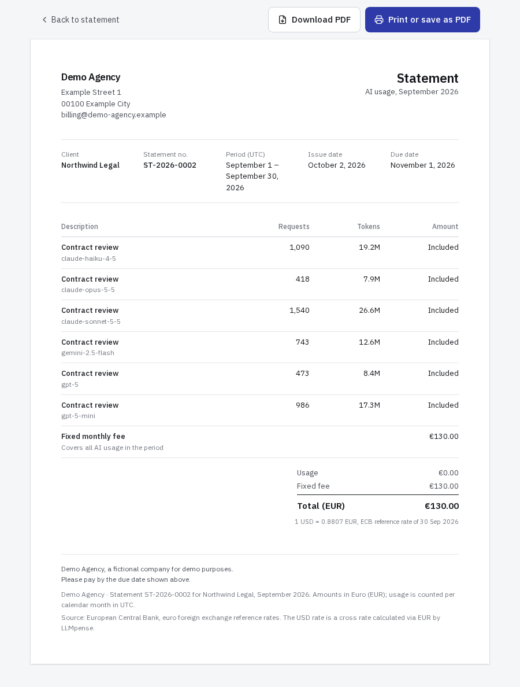

# LLMpense

**Know what you spend on AI, in tokens and dollars, for every client and project.**

LLMpense is a self-hostable AI spend tracker for agencies and dev shops that build
AI features for clients. Point your OpenAI, Anthropic or Gemini SDK at the LLMpense
proxy, tag requests with a client and project, and see what you spend per client,
project, model and feature, plus what each client is billed for it. It works on
phone and desktop.

> Status: early MVP (v0.1). Expect breaking changes.

## Screenshots

<picture>
  <source media="(prefers-color-scheme: dark)" srcset=".github/screenshots/desktop-overview-dark.png">
  
</picture>

<p align="center">
<picture>
  <source media="(prefers-color-scheme: dark)" srcset=".github/screenshots/mobile-overview-dark.png">
  
</picture>
<picture>
  <source media="(prefers-color-scheme: dark)" srcset=".github/screenshots/mobile-chart-dark.png">
  
</picture>
<picture>
  <source media="(prefers-color-scheme: dark)" srcset=".github/screenshots/mobile-client-dark.png">
  
</picture>
</p>

<picture>
  <source media="(prefers-color-scheme: dark)" srcset=".github/screenshots/desktop-client-dark.png">
  
</picture>

<picture>
  <source media="(prefers-color-scheme: dark)" srcset=".github/screenshots/desktop-statements-dark.png">
  
</picture>

<picture>
  <source media="(prefers-color-scheme: dark)" srcset=".github/screenshots/desktop-results-dark.png">
  
</picture>

<p align="center">
  
</p>

## How it works

```
your app ──► LLMpense proxy ──► OpenAI / Anthropic / Gemini
              │  reads token usage from the response (streaming included)
              ▼
           Postgres ◄── ingest API (for usage you report yourself)
              ▲
           dashboard: cost, billed, margin, budgets, CSV export
```

- **Drop-in proxy.** Change the base URL and add headers. Your provider key passes
  through untouched and is never stored.
- **Per-client billing rules.** Markup, pass-through, fixed monthly fee or absorbed.
- **Authoritative cost.** Prices are merged from four public price lists, with your
  own overrides and negotiated discounts on top (see [Price data](#price-data)).
- **Budgets and alerts** per org, client or project.
- **Cost per result**: group the calls of one task (a ticket, a document, an agent run) under a
  run id, report how each run ended, and see what a successful result costs, failed attempts
  included, per outcome, client, project and model, with success rates, value per dollar and runs
  still waiting for an outcome (see [Cost per result](#cost-per-result)).
- **Fixed-fee loss alerts** when a fixed-fee client's month-to-date provider cost exceeds
  the part of its fee earned so far.
- **Monthly statements** per client and calendar month (UTC). Drafts are computed live;
  closing a month freezes its totals, line items and exchange rate, and a closed month can be
  reopened. Close, reopen and "close all drafts" ask for confirmation first.
- **Billing currencies**: bill clients in USD, EUR, GBP, JPY, CNY or CHF. Costs, margins and
  dashboards stay in USD; statements convert each line with the month's ECB euro reference
  rate (last business day of the month), and fixed fees are set in the client's currency.
  Rates come from `pnpm fx:sync` or a daily fetch by the dashboard; manual rates per agency
  take precedence, for offline installs or contractual rates.
- **Client-facing statements** with your agency's name, address, logo and footer, showing
  only what the client is billed, in its currency. Model names can be hidden per agency or
  per client (one line per project). Print-ready, so "Save as PDF" gives a clean A4 document.
- **Statement lifecycle**: draft → closed → sent → paid, with a timestamp and history entry for
  every change. A sent or paid statement has to be unmarked step by step before it can be
  reopened. Mark one statement on its page or several at once on the month overview, which
  filters by status; every step asks for confirmation.
- **Statement numbers and due dates**: the first close assigns a gap-free number per agency in a
  configurable format (e.g. `ST-{YYYY}-{NNNN}` gives `ST-2026-0001`); reopening keeps it. The
  issue date is the close date (it can be changed when marking as sent), the due date adds the
  payment terms (agency default 14 days, overridable per client), and sent statements past
  their due date show as overdue.
- **PDF download**: the client-facing statement as a server-generated A4 PDF with embedded fonts,
  your branding and logo (PNG or JPEG), number, dates, line items, totals and the exchange-rate
  note, e.g. `ST-2026-0001-acme-retail-2026-09.pdf`.
- **Accounting CSV**: line items per statement, one row per client per month (with currency,
  rate, USD equivalent, statement number and dates), and the monthly usage export per client.
- **Accounting exports** (files only, no connection to these services): a Xero sales invoice
  import CSV and a DATEV Buchungsstapel (EXTF format, Windows-1252) with one invoice or posting
  per closed, sent or paid statement of a month. Account codes, tax rate or tax key and DATEV
  consultant and client numbers are set under Settings > Accounting export. Lexware Office has no
  file import for sales invoices; upload the PDFs there instead.

## Quick start

Requirements: Node 22+, pnpm, Docker.

```bash
cp .env.example .env          # optional: set ADMIN_PASSWORD (+ SESSION_SECRET) to require a login
docker compose up -d --wait   # Postgres on localhost:5433
pnpm install
pnpm db:migrate
pnpm db:seed                  # demo agency with 60 days of traffic; prints an API key
pnpm dev                      # dashboard http://localhost:3000, proxy http://localhost:8787
```

Send a request through the proxy:

```ts
import OpenAI from "openai";

const openai = new OpenAI({
  baseURL: "http://localhost:8787/openai/v1",
  defaultHeaders: {
    "x-llmpense-key": process.env.LLMPENSE_KEY,   // lpk_... from Settings or the seed output
    "x-llmpense-client": "acme-retail",
    "x-llmpense-project": "support-bot",
  },
});
```

More SDK examples (Anthropic, Python, curl): [apps/proxy/README.md](apps/proxy/README.md).

## Cost per result

A **run** is one task, such as a support ticket or a reviewed contract. Give every LLM call of a
run the same id, then report the run's **outcome** when it is done:

```ts
// 1. Tag each call with the run id (proxy header; ingest API field `runId`;
//    gateways: metadata key `llmpense_run` or tag `run:<id>`).
await openai.chat.completions.create(
  { model: "gpt-5-mini", messages },
  { headers: { "x-llmpense-run": "ticket-4711" } },
);
```

```bash
# 2. Report how the run ended (same API key, up to 1,000 outcomes per call).
curl -X POST http://localhost:3000/api/v1/outcomes \
  -H "Authorization: Bearer $LLMPENSE_KEY" \
  -H "content-type: application/json" \
  -d '{"outcomes":[{"runId":"ticket-4711","name":"ticket_resolved","status":"success",
       "value":{"amount":4,"currency":"USD"}}]}'
```

- `name` is a short identifier (letters, digits, `_ . : -`), `status` is `success` or `failure`;
  `value` (amount and currency: USD, EUR, GBP, JPY, CNY or CHF), `ts` and `metadata` are optional.
- One run may report several outcomes with different names. Reporting the same run and name again
  updates it; without `ts` the original time stays. Outcomes may arrive before the usage.
- Responses: `200 {"received", "upserted"}`, `400` with zod `issues`, `401` for a missing or
  unknown key.

The Results page shows, per outcome name and for the selected range (by outcome date):

- **Cost per success** = total cost of every run that reported the outcome, successful or failed,
  divided by the successes. Also the average cost per run and the success rate.
- **Value per $1** = values of successful outcomes in USD (each converted at the rate of its
  outcome date) divided by the total cost.
- Breakdowns by client, project and model (a run counts under one only when all its calls share
  it; others show as "several"), the model with the lowest cost per success, and a "low sample"
  mark for fewer than 20 runs.
- Runs with usage but no outcome yet, with what they have cost so far.

## Already using a gateway?

LLMpense can import usage pushed from tools you already run, without moving traffic to the proxy:

- **LiteLLM proxy** via its `generic_api` logging callback
- **Helicone** via webhooks (signature verification supported)
- **OpenRouter** via Broadcast to a webhook destination

Costs are computed from the LLMpense price table, and requests are attributed to clients and
projects from metadata keys or `client:` / `project:` tags. Setup per tool:
[apps/web/INTEGRATIONS.md](apps/web/INTEGRATIONS.md).

## Repository layout

| Path | What |
|---|---|
| `apps/proxy` | Streaming metering proxy (Hono) |
| `apps/web` | Dashboard and ingest API (Next.js) |
| `packages/core` | Usage event schema, pricing, cost and billing rules, price sync |
| `packages/db` | Postgres schema (Drizzle), migrations, event recording, demo seed |

## Price data

The bundled price table is compiled by `pnpm prices:sync` from these MIT-licensed
price lists:

- [LiteLLM](https://github.com/BerriAI/litellm)
- [genai-prices](https://github.com/pydantic/genai-prices) by Pydantic
- [models.dev](https://github.com/sst/models.dev)
- [Portkey Models](https://github.com/Portkey-AI/models)

Their license notices are in [THIRD_PARTY_NOTICES.md](THIRD_PARTY_NOTICES.md).

## Exchange rates

Source: European Central Bank,
[euro foreign exchange reference rates](https://www.ecb.europa.eu/stats/policy_and_exchange_rates/euro_reference_exchange_rates/html/index.en.html).
The ECB quotes rates per euro; LLMpense calculates USD cross rates from them via EUR.

```bash
pnpm fx:sync                    # last 90 days (run daily, e.g. from cron)
pnpm fx:sync --feed=history     # everything since 1999, to backfill old months
```

The dashboard also fetches the 90-day feed at most once a day when the newest stored rate is
older than today, waiting at most 1.5 seconds before it uses the stored rates. Set
`FX_AUTO_FETCH=0` to turn that off; manual rates go under Settings > Exchange rates. The demo
seed inserts a few demo rates (labelled as seed data) only when no ECB rates are stored.

## License

LLMpense is **source-available** under the
[Functional Source License 1.1, Apache 2.0 Future License](LICENSE) (FSL-1.1-ALv2).
You can use, modify and self-host it freely, including for client work. You may
not offer it as a competing commercial product or service. Every release becomes
Apache-2.0 two years after it is published. Contributions require signing the
[CLA](CLA.md); see [CONTRIBUTING.md](CONTRIBUTING.md).

